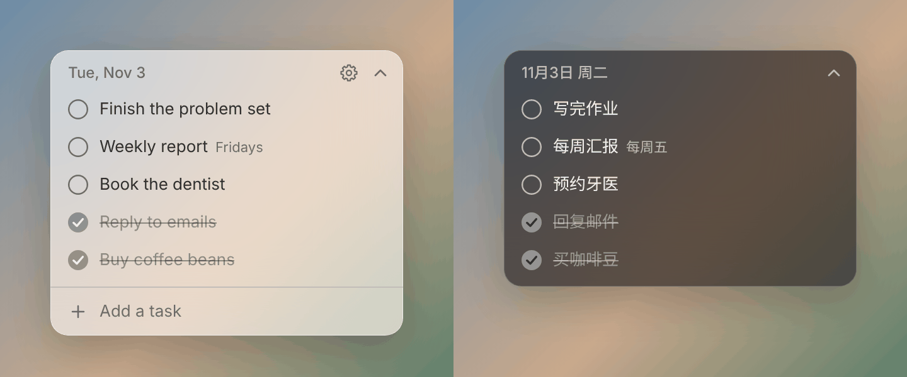

# FloatTodo

A minimal floating daily to-do list for Mac.

极简的每日悬浮待办清单。

[English](#english) | [中文](#中文)



## English

FloatTodo is a small frosted-glass window that stays above your other windows, even over full-screen apps. When you finish a task, it turns gray, gets crossed out, and sinks to the bottom. It disappears after 4 a.m. the next day.

Your tasks stay on your Mac. There's no account, and the app doesn't use the network.

### Install

You need macOS 11 or later.

```bash
git clone https://github.com/cspring927/FloatTodo.git
cd FloatTodo
bash install.command
```

The script builds the app on your Mac, installs it to `~/Applications`, and starts it. It doesn't need an admin password. If Apple's Command Line Tools are missing, it opens their installer. Run the script again when they finish.

FloatTodo opens at login by default. You can turn this off in Settings, and macOS may show a notice that a background item was added.

### Use

| To | Do this |
| --- | --- |
| Add a task | Hover over the window, type in the box at the bottom, and press Return. Paste several lines to add several tasks. |
| Finish a task | Click the circle. |
| Edit a task | Click its text. Press Return to save or Esc to cancel. |
| Delete a task | Hover over it and click ×. You can undo for 5 seconds, or press ⌘Z. |
| Repeat a task | Hover over it, click ↻, and choose daily or a day of the week. It comes back on its next day, and unfinished tasks don't pile up. |
| Reorder tasks | Drag a task up or down. |
| Move the window | Drag the date bar or any empty space. |
| Resize the window | Drag the left, right, or bottom edge, or a bottom corner. Dragging the bottom edge fixes the height. Double-click it to return to automatic height. |
| Collapse the window | Click the arrow at the top right. You can check off the next task from the slim bar. |
| Show or hide the window | Press ⌃⌥T. |

### Settings

To open Settings, hover over the window and click the gear. You can also use the menu bar icon, or right-click the window.

You can change the language (English or 中文), appearance, transparency, and login behavior, and stop repeating tasks.

**To customize the shortcut,** click the button that shows the current shortcut, then press a new combination. It must include ⌃, ⌥, or ⌘. Press Esc to cancel.

### Uninstall

```bash
bash uninstall.command
```

This keeps your tasks in `~/Library/Application Support/FloatTodo`. Delete that folder if you don't want them.

### License

[MIT](LICENSE)

## 中文

FloatTodo 是一个磨砂玻璃小窗，始终浮在其他窗口上方，全屏 app 上也能看到。任务做完后会变灰、划线并沉到底部，第二天凌晨 4 点之后消失。

任务只保存在你的 Mac 上，不需要注册账号，app 也不联网。

### 安装

需要 macOS 11 或更高版本。

```bash
git clone https://github.com/cspring927/FloatTodo.git
cd FloatTodo
bash install.command
```

脚本会在你的 Mac 上编译，安装到 `~/Applications` 并启动，不需要管理员密码。如果缺少 Apple 的命令行开发工具，脚本会打开安装窗口，装好后再运行一次就行。

FloatTodo 默认开机自动启动，可以在设置里关掉。macOS 可能会提示已添加后台项目。

### 怎么用

| 想做什么 | 怎么做 |
| --- | --- |
| 添加任务 | 鼠标移到小窗上，在底部的输入框输入，按回车。一次粘贴多行，会变成多个任务。 |
| 完成任务 | 点圆圈。 |
| 修改任务 | 点文字。按回车保存，按 Esc 取消。 |
| 删除任务 | 鼠标移到任务上，点 ×。5 秒内可以撤销，也可以按 ⌘Z。 |
| 重复任务 | 鼠标移到任务上，点 ↻，选每天或每周几。到下一次该做的那天会重新出现，没做完的不会堆积。 |
| 调整顺序 | 按住任务上下拖动。 |
| 移动窗口 | 拖动日期那一栏或任何空白处。 |
| 调整大小 | 拖动左右边缘、下边缘或下角。拉过下边缘后高度会固定，双击下边缘恢复自动高度。 |
| 收起成小条 | 点右上角的箭头。小条上可以直接勾掉下一件事。 |
| 显示或隐藏 | 按 ⌃⌥T。 |

### 设置

鼠标移到小窗上，点齿轮就能打开设置。也可以点菜单栏图标，或者右键点小窗。

在这里可以调语言（中文或 English）、外观、透明度和开机启动，也可以停止重复任务。

**自定义快捷键：** 点显示当前快捷键的按钮，再按下新的组合键。组合键要包含 ⌃、⌥ 或 ⌘ 中的至少一个，按 Esc 取消。

### 卸载

```bash
bash uninstall.command
```

卸载后，任务还保留在 `~/Library/Application Support/FloatTodo`。如果不需要了，删掉这个文件夹就行。

### 许可证

[MIT](LICENSE)
